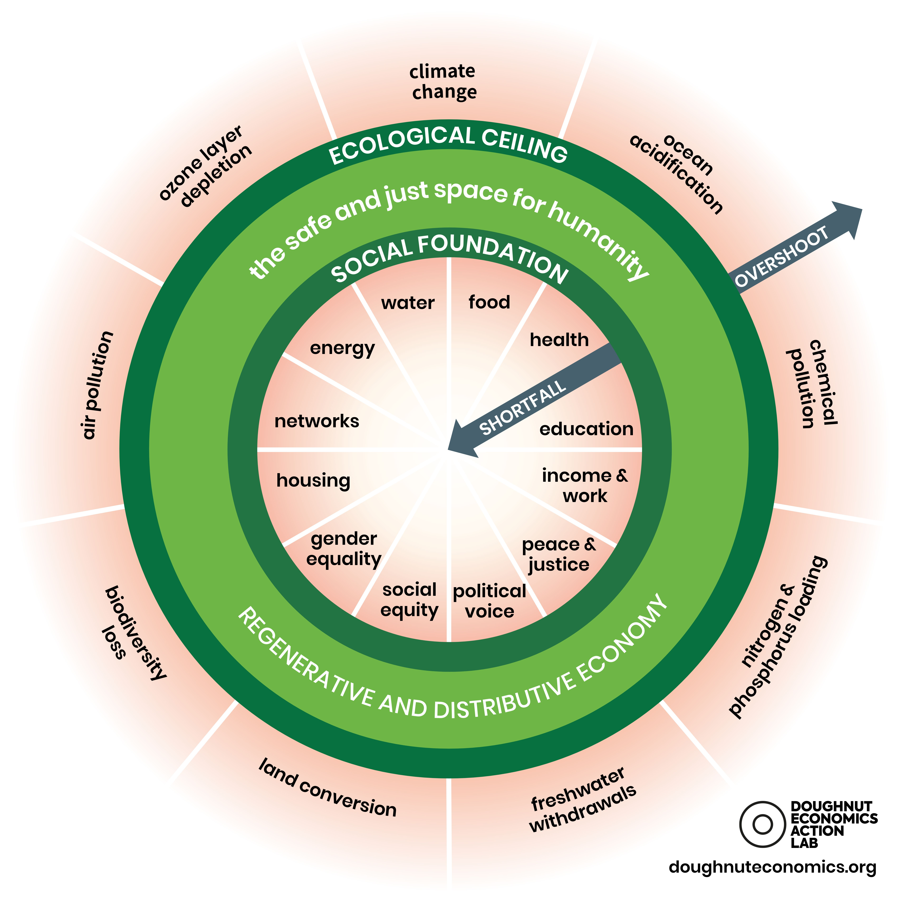

# R38ET_mesh
[](LICENSE)
[](https://www.python.org/downloads/)
[](https://github.com/markqvist/Reticulum)
[](https://catala-lang.org/)


**Peer-to-peer, decentralized, resilient, human Web of Trust for democratic bottom-up decision-making.**

## Abstract
**R38ET_mesh** (read *"reset '38 mesh"*) is an open socio-ecological coordination framework and off-grid protocol primitive designed to replace centralized bureaucracies, market extraction, and debt dependencies with self-sovereign human stewardship.
The R38ET movement aims to replace the turbo-capitalist, competitive zeitgeist, driven by a constant **“Let’s go!”**, with cooperation, trust and equity. **“Let go.”** of greed, centralized property and control claims. Freedom is not generated by the continuous accumulation of new regulatory and coercive means; rather, letting go of centralized property and governance structures creates the space for organic, relationally grounded community.

Operating entirely serverless over the **[Reticulum Network Stack (RNS)](https://github.com/markqvist/Reticulum)** and **[LXMF](https://github.com/markqvist/LXMF)**, R38ET_mesh pairs a physical, bot-resistant **Web of Trust (WoT)** with a **Git-native Norm Library** (`rngit`) and a DSL-based legal verifier (**NormLinter** powered by **[Catala](https://catala-lang.org/)**). It binds direct democracy boards (*Levels 1–7*) within a shield of fundamental human rights (*Level 8 Invariants*) and planetary biocapacity limits (*33-Bit GHA Tile Allocation*).

## Status Quo
Modern socio-economic systems face compounding structural crises rooted in institutional centralization, financialization, and technocratic enclosure:

- **Capitalism is not working**
	- Profit as the prime objective
	- Accumulation of wealth
	- **Alienation & Commodity Fetishism:** Capitalist market dynamics systematically detach human beings from the means and fruits of their creative labor. Human creative force, bodily integrity, and social care are reduced to mere tradable commodities within an extractive market framework.
	- **Compulsory Compound Growth & Debt Dependencies:** Debt-based monetary regimes enforce an inescapable growth imperative. To service interest-bearing debt, economies must continuously expand, leading to systemic capital concentration, monopolization, and the ongoing *Enclosure of the Commons*.
	- **Technocratic Enclosure & Systemic Extraction:** Natural ecosystems and human communities are treated as passive inventories (*Bestand*) to be exploited. Traditional top-down regulatory state apparatuses and private corporate monopolies accelerate ecological overshoot and social shortfalls while enforcing surveillance-based compliance.
- **The current Legislative is a pseudo-democracy**
	- Anachronistic voting terms too slow: 4 years is way too long a period to hear the voice of the sovereign.
	- De facto Lobbycracy: Accumulated Wealth directly translates to political influence and skews decision making in favour of *the 1 %*.

## Solutions for a New Millennium
R38ET_mesh synthesizes a 3,000-year [philosophical lineage](docs/PHILOSOPHY.md) into formal logic and decentralized infrastructure. A paradigm of **relational human stewardship**, replaces coercive bureaucracies with direct democratic participation.

### Socio-Ecological Foundation & Governance Architecture 



- **Doughnut Economics / [DEAL](https://doughnuteconomics.org/) (Macro-Framework & Eco-Social Accounting):**  
Kate Raworth's Doughnut Economics form governance boundaries. The **Social Foundation** is codified as unconditional human rights, while the **Ecological Ceiling** (planetary limits) is bounded by local and global biocapacity tiles (`gha_tile`), securing every individual's equal claim to the global commons ($1/2^{33}$).
- **Polycentric Commons Governance (Micro- & Meso-Level Democracy):**  
Elinor Ostrom's Nobel Prize-winning [design principles](https://en.wikipedia.org/wiki/Elinor_Ostrom#%22Design_principles_illustrated_by_long-enduring_CPR_(Common_Pool_Resource)_institutions%22) for collective action structure the democratic process. Decision-making originates at local neighborhood `boards` and scales upward via subsidiarity, while functional service execution is delegated to transparent executive `committee`.

- **Kelsenian Legal Determinism (*Reine Rechtslehre*):**  
Adopts Hans Kelsen's Pure Theory of Law and the *Stufenbau der Rechtsordnung* (hierarchy of legal norms). Norm validity is determined structurally (*Lex Superior*, *Lex Specialis*, *Lex Posterior*) rather than by corruptable political delegates.
- **Plural Tools ([RadicalxChange](https://www.radicalxchange.org/)):**  
Implementation of Plural Voting to prioritize broad community consensus over factional polarization.
- **Universal Basic Share (UBS):**  
Unconditional physical survival entitlement (water & food, housing & energy, education & public infrastructure), independent of credits.
- **Universal Basic Income (UBI):**  
1000 ₢ / month (credits) are granted for personal desires, plus up to 2000 ₢ / month earned via community service. Unrestricted spending with long-term decay to prevent accumulation.

### The Matrix of Sovereignty

| Level | Legislative Board | Executive Committee | Norm Hierarchy |
| :---: | :--- | :--- | :--- |
| **8** | Global Assembly | Planetary Committee | **Basic Human Rights** |
| **7** | Continental Council | Peace / Continental Coordination | Continental Accords |
| **6** | Federal Parliament | Justice & Social Equity | Federal Law |
| **5** | State Senate | Transportation & Networks | State Acts |
| **4** | Regional Congress | Production & Infrastructure | Regional Statutes |
| **3** | City Council | Housing, Health, Education Services | City Codes |
| **2** | District Bureau | Resource Distribution Workgroups | District Directives |
| **1** | Neighborhood Board | Political Voice | Local Agreements |

### Dual Cascades
- **TOP-DOWN CASCADE** (Lex Superior)
	- Level 8: GlobalAssembly (Highest Council & Constitutional Layer; Eco-Ceiling Invariants)
	- Level 7..1: Subordinate norms MUST satisfy Level-8 invariants (Evaluated fail-closed by NormLinter via Catala pre-merge-commit hook)
- **BOTTOM-UP CASCADE** (Subsidiarity, Lex Specialis)
	- Level 1: Local Neighborhood Councils ratify grassroots rules
	- Level 2..8: The next higher council decides whether to adopt a norm upward

### Roadmap (2026 – 2038 / 13038 Anno Sat)
- **Milestone 1 — Framework Release:** Core off-grid mesh stack, `sp0t-node.py`, and `schema.json` deployment.
- **Milestone 2 — Growing Mesh:** Formation of the first Neighborhood Councils.
- **Milestone 3 — Local Governance:** Regional council integration and executive committee delegation (Water, Energy, Health).
- **Milestone 4 — Global Propagation:** Interconnecting regional mesh bubbles into a worldwide peer-to-peer federation via `rngit`.
- **Milestone 5 — Critical Mass:** Over 50% of global population verified within the physical Web of Trust.
- **Milestone 6 — Planetary Reset (January 19, 2038 / 13038 Anno Sat):** Solonian Debt Jubilee (*Seisachtheia*), deprecation of coercive bureaucracies, and declaration of the UN 3.0 Global Constitution.

## The `sp0t-node` Software
The architecture replaces heavy relational databases and complex custom parsers, with a **distributed repository** (`NormLibrary`) as the single source of truth and **Catala** for formal logic checks.

### Core Architecture Components

#### Mesh Infrastructure & Transport
- **Reticulum** [RNS](https://github.com/markqvist/Reticulum) & [LXMF](https://github.com/markqvist/LXMF): A zero-trust, cryptography-based P2P networking stack running across any physical medium (LoRa radio, packet radio, serial links, local Wi-Fi, TCP/IP). RNS provides self-configuring, censorship-resistant routing and end-to-end encrypted asynchronous messaging without reliance on global IP infrastructure, domain name registrars, encryption certificates or central servers.

#### Human-Only Web of Trust (WoT)
- **Short Authentication String (SAS) Commit-Reveal Handshake & Progressive Admission:** A face-to-face, 6-digit cryptographic verification protocol anchoring digital identities directly into physical, interpersonal social relationships. Prevents automated bots, Sybil attacks, and central state identity providers without requiring passports or government documents. Admission is progressive: a node is admitted to the local council on its 1st valid physical attestation, with subsequent attestations building a transparent trust-quotient graph.

#### Norm Library
- **Git as DAG Ledger:** All norm amendments, and WoT attestations are committed via `rngit` and signed using Reticulum Ed25519 identity keys.

#### Norm Linter
- **Domain Specific Language (DSL):** Candidate norms are validated via [Catala](https://catala-lang.org/) logic evaluation `catala check` before `git merge`. If a proposal violates any higher-level norm, the merge is rejected and the conflict is pointed out.

#### Spatial & Ecological Dual-Coordinates
- `BoardTile`: 29-bit integer (`BitVec<29>`, incrementing from `0x00000001` to `0x1FFFFFFF`).
- `GhaTile`: 33-bit integer (`BitVec<33>`, decrementing from `0x1FFFFFFFF` down to `0x000000001`), securing every individual's equal claim to the global commons by allocating a [global hectare](https://footprintnetwork.org/resources/glossary/#:~:text=global%20hectare%20(gha)) biocapacity tile ($1/2^{33} \approx 8.59\text{ billion}$).

#### Onboarding & Polis (Public Discourse) via `Reticulum Relay Chat`
Every `NeighborhoodBoard` is linked to a public RRC channel address, directly derived from its 29-bit ID: `rrc/board/<board_tile_hex>` (e.g., rrc/board/0x00000042) 
- **Zero-Directory Discovery:** New nodes join their local neighborhood channel automatically upon selecting their location, without central server registries.
- **Plenary & Outreach:** RRC serves as the open broadcast channel for council agendas, community meetings, and requesting physical SAS handshakes.

### Current Repository State
```
r38et-mesh/
├── assets/                   # Media & illustrations
├── config/                   
│   └── board.json            # Neighborhood board initialization & council configs
├── docs/                     # Documentation
│   └── PHILOSOPHY.md         # Philosophical lineage
├── norms/                    # Catala DSL specifications
│   └── level_8/              # Constitutional basic human rights & invariants
├── schemas/                  # Formal JSON schemas for BitVecs, WoT & lifecycle
│   └── governance.json       
├── src/                      # Python package & protocol implementations
│   └── sp0t_node.py
├── tests/                    # Unit & integration test suites
│   └── test_sp0t_node.py
├── wot/                      # Local Web of Trust state graph
│   └── attestations.json
├── pyproject.toml            # PEP 621 package & tool configurations
├── sp0t-node.py              # CLI launcher
├── LICENSE                   # GNU General Public License v3.0
└── README.md                 # Project manifesto & architectural blueprint
```

## Quickstart

### 1. Dependencies

- **Core Runtime (Python 3.10+):**
  Install [Python](https://www.python.org/downloads/) and mesh dependencies:
  ```bash
  pip install rns jsonschema
  ```

- **Optional: Legal DSL Compiler ([Catala](https://catala-lang.org/)):**
  Required only for formal norm verification (`catala check`) via [OCaml/opam](https://ocaml.org/install):
  ```bash
  opam install catala
  # Optional IDE / editor language server:
  # opam install catala-lsp
  ```

### 2. Install `sp0t-node`
https://github.com/R38ET/release/latest

### 3. Start the Daemons `rns` and `sp0t-node`

```bash
rnsd -s
python3 sp0t-node.py start
```

## License
Documentation (`.md`) is licensed under **CC BY-SA 4.0** and code (`.py`, `.json`) under **GPL-3.0+**.  
See [LICENSE](LICENSE) for details.
