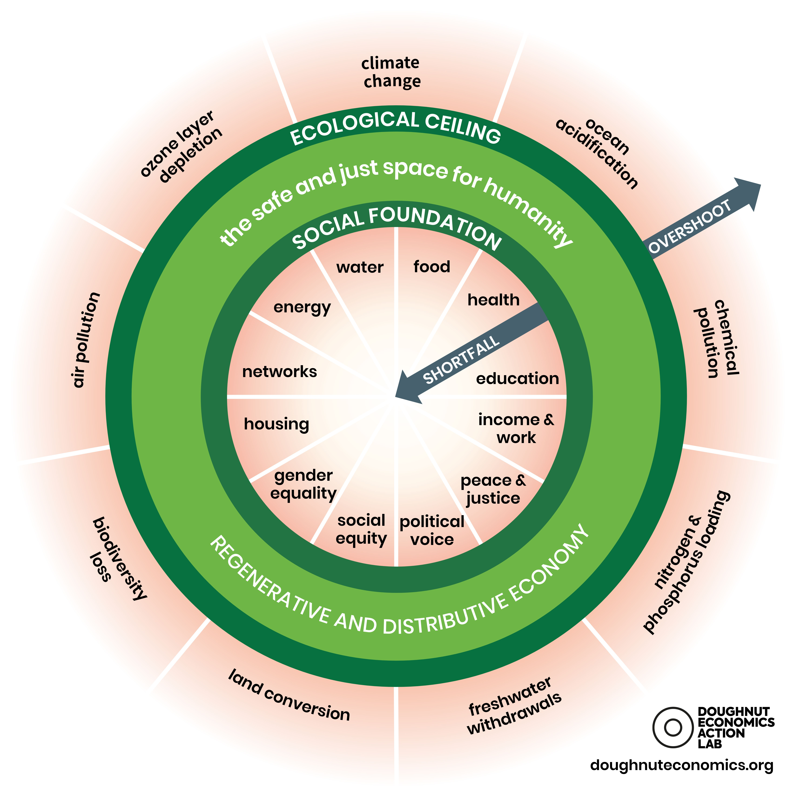

# Status Quo
Modern socio-economic systems face compounding structural crises rooted in institutional centralization, financialization, and technocratic enclosure:

- **Capitalism is not working**
	- Profit as the prime objective
	- Accumulation of wealth
	- **Alienation & Commodity Fetishism:** Capitalist market dynamics systematically detach human beings from the means and fruits of their creative labor. Human creative force, bodily integrity, and social care are reduced to mere tradable commodities within an extractive market framework.
	- **Compulsory Compound Growth & Debt Dependencies:** Debt-based monetary regimes enforce an inescapable growth imperative. To service interest-bearing debt, economies must continuously expand, leading to systemic capital concentration, monopolization, and the ongoing *Enclosure of the Commons*.
	- **Technocratic Enclosure & Systemic Extraction:** Natural ecosystems and human communities are treated as passive inventories (*Bestand*) to be exploited. Traditional top-down regulatory state apparatuses and private corporate monopolies accelerate ecological overshoot and social shortfalls while enforcing surveillance-based compliance.
- **The current Legislative is a pseudo-democracy**
	- Anachronistic voting terms too slow: 4 years is way too long a period to hear the voice of the sovereign.
	- De facto Lobbycracy: Accumulated Wealth directly translates to political influence and skews decision making in favour of *the 1 %*.

# Solutions for a New Millennium
R38ET_mesh synthesizes a 3,000-year [philosophical lineage](PHILOSOPHY.md) into formal logic and decentralized infrastructure. A paradigm of **relational human stewardship**, replaces coercive bureaucracies with direct democratic participation.

## Socio-Ecological Foundation & Governance Architecture 

- **Doughnut Economics / [DEAL](https://doughnuteconomics.org/) (Macro-Framework & Eco-Social Accounting):**  
Kate Raworth's Doughnut Economics form governance boundaries. The **Social Foundation** is codified as unconditional human rights, while the **Ecological Ceiling** (planetary limits) is bounded by a [global hectare](https://footprintnetwork.org/resources/glossary/#:~:text=global%20hectare%20(gha)) biocapacity tile (`gha_tile`), securing every individual's equal claim to the global commons ($1/2^{33}$).
- **Polycentric Commons Governance (Micro- & Meso-Level Democracy):**  
Elinor Ostrom's Nobel Prize-winning [design principles](https://en.wikipedia.org/wiki/Elinor_Ostrom#%22Design_principles_illustrated_by_long-enduring_CPR_(Common_Pool_Resource)_institutions%22) for collective action structure the democratic process. Decision-making originates at local neighborhood `boards` and scales upward via subsidiarity, while functional service execution is delegated to transparent executive `committee`.
- **Kelsenian Legal Determinism (*Reine Rechtslehre*):**  
Adopts Hans Kelsen's Pure Theory of Law and the *Stufenbau der Rechtsordnung* (hierarchy of legal norms). Norm validity is determined structurally (*Lex Superior*, *Lex Specialis*, *Lex Posterior*) rather than by corruptable political delegates.
- **Plural Tools ([RadicalxChange](https://www.radicalxchange.org/)):**  
Implementation of Plural Voting to prioritize broad community consensus over factional polarization.
- **Universal Basic Share (UBS):**  
Unconditional physical survival entitlement (water & food, housing & energy, education & public infrastructure), independent of credits.
- **Universal Basic Income (UBI):**  
1000 ₢ / month (credits) are granted for personal desires, plus up to 2000 ₢ / month earned via community service. Unrestricted spending with long-term decay to prevent accumulation.

## The Matrix of Sovereignty

| Level | Legislative Board | Executive Committee | Norm Hierarchy |
| :---: | :--- | :--- | :--- |
| **8** | Global Assembly | Planetary Committee | **Basic Human Rights** |
| **7** | Continental Council | Peace / Continental Coordination | Continental Accords |
| **6** | Federal Parliament | Justice & Social Equity | Federal Law |
| **5** | State Senate | Transportation & Networks | State Acts |
| **4** | Regional Congress | Production & Infrastructure | Regional Statutes |
| **3** | City Council | Housing, Health, Education Services | City Codes |
| **2** | District Bureau | Resource Distribution Workgroups | District Directives |
| **1** | Neighborhood Board | Political Voice | Local Agreements |

## Dual Cascades
- **TOP-DOWN CASCADE** (Lex Superior)
	- Level 8: GlobalAssembly (Highest Council & Constitutional Layer; Eco-Ceiling Invariants)
	- Level 7..1: Subordinate norms MUST satisfy Level-8 invariants (Evaluated fail-closed by NormLinter via Catala pre-merge-commit hook)
- **BOTTOM-UP CASCADE** (Subsidiarity, Lex Specialis)
	- Level 1: Local Neighborhood Councils ratify grassroots rules
	- Level 2..8: The next higher council decides whether to adopt a norm upward

## Roadmap (2026 – 2038 / 13038 Anno Sat)
- **Milestone 1 — Framework Release:** Core off-grid mesh stack, `sp0t-node.py`, and `schema.json` deployment.
- **Milestone 2 — Growing Mesh:** Formation of the first Neighborhood Councils.
- **Milestone 3 — Local Governance:** Regional council integration and executive committee delegation (Water, Energy, Health).
- **Milestone 4 — Global Propagation:** Interconnecting regional mesh bubbles into a worldwide peer-to-peer federation.
- **Milestone 5 — Critical Mass:** Over 50% of global population verified within the physical Web of Trust.
- **Milestone 6 — Planetary Reset (January 19, 2038 / 13038 Anno Sat):** Solonian Debt Jubilee (*Seisachtheia*), deprecation of coercive bureaucracies, and declaration of the UN 3.0 Global Constitution.
